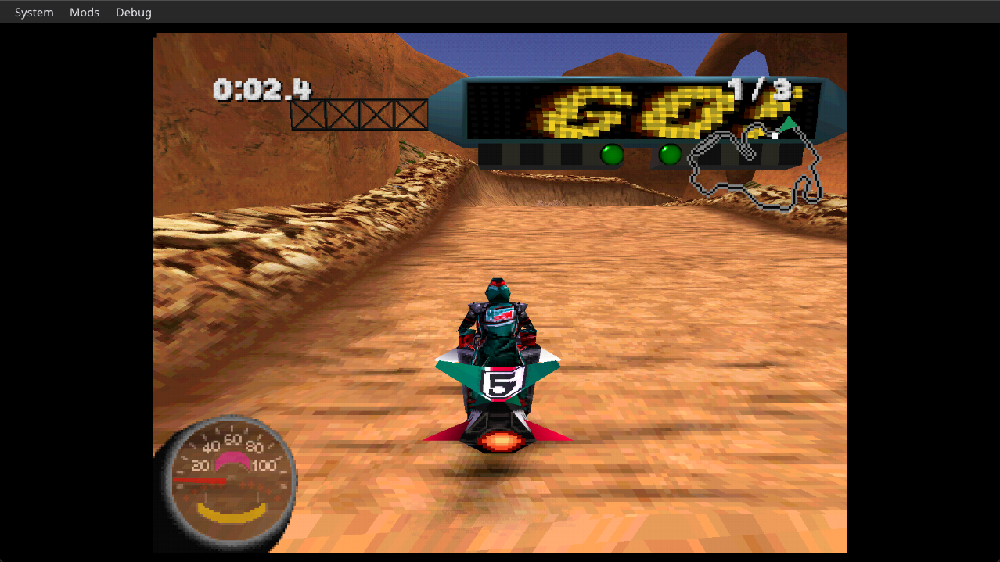

# Jet Moto 2 Recompiled

A native PC build of **Jet Moto 2: Championship Edition** (PlayStation, 1998, SCUS-94167), made by
statically recompiling the game's MIPS code to C# with [RecompOne](https://github.com/BlackLabelHQ/RecompOne).
No emulator and no BIOS. **Bring your own disc** - this repository and its releases contain no game code or data.



## Status

Early release, tested on Windows 11 x64 only.

| Works | Not tested yet |
|---|---|
| Boot logos, title and menus | Sound and CD music (never listened to) |
| Attract demo | Memory card saving |
| A full player-controlled race (tried on Slickrock Gorge) | The other 19 tracks, season modes |
| Keyboard input, cheats menu | Two-player, gamepads |

Known oddity: on the 640x480 menu screens the artwork runs off the right edge. It has not been compared
against real hardware.

## Install

You need Windows x64, the [.NET 10 SDK](https://dotnet.microsoft.com/download/dotnet/10.0)
(`winget install Microsoft.DotNet.SDK.10`) and your own dump of the USA Championship Edition disc.

1. Download the release zip and extract it.
2. Copy your disc image (`.cue` + 17 `.bin` tracks, Redump names) into `disc\`.
3. Run `JetMoto2.exe`. The first run recompiles the game from your disc and builds it, which takes a few
   minutes; after that the same exe just starts the game. `JetMoto2.exe --rebuild` forces a rebuild.

With [Quiver Launcher](https://quiverlauncher.com), install the tile, open its folder, do step 2 and press Play.

## Controls

Default keyboard: `Z` Cross (thrust), `X` Circle, `A` Square, `S` Triangle (turbo), `Enter` Start,
`Right Shift` Select, arrow keys. Rebind under **System > Settings**. `F1` hides the menu bar.

## Cheats

**Cheats** in the top menu bar; choices are saved in `build\cheats.json`.

- **Infinite Turbo** - verified in a race.
- **Infinite Grapple** - same record layout as the turbo cheat, not exercised in play yet.
- **Apply to CPU riders too**

Published GameShark codes for SCUS-94167 are for the 1997 Jet Moto 2 and do not fit this disc:
Championship Edition is a different build under the same serial and those addresses land on program code.
The addresses used here were found in this build (see `patches/Cheats.cs`).

## Building from source

```
git clone --recursive https://github.com/goodshepherd23/JetMoto2-Recomp
```

Put the disc in `disc\`, then either run the launcher project (`dotnet run --project tools/Launcher`) or:

```
dotnet build RecompOne/RecompOne.Recompiler -c Release
RecompOne/RecompOne.Recompiler/bin/Release/net10.0/recompone.exe config/JetMoto2.json
dotnet build JetMoto2Recomp.csproj -c Release -o build
```

`.vscode/` has matching tasks and an F5 debug config for VS Code.

### What this game needed

- **Overlay load addresses.** RecompOne's `--autoconfigure` guesses them from the code and gets this game
  wrong. The real ones come from the game's own loader: `BIN/JM2SHELL.BIN` loads at `0x800C10B8` and each
  of the twenty per-track `BIN` files at `0x801020B8`. `tools/FuncMapGen` builds the config and function
  maps with those, and `tools/fix_funcmaps.py` repairs function starts the linear sweep misplaces.
  The results are committed in `config/`.
- **`CdReadSync`** must report drive status `0x22` or the game's file loader retries forever
  (`patches/CdPatches.cs`).
- **`StoreImage`** is replaced for VRAM outside the frame buffers (`patches/GpuPatches.cs`). The menus
  upload a palette and read it straight back to build their glowing cursors; RecompOne's GL renderer
  answers a same-frame readback with stale VRAM, which turned the race-type cursor into green speckles
  and the track-dial pointer into a grey square.
- **libpad** replacements are disabled: the game uses `PadInit`/`PadRead`, so its own libpad runs against
  the emulated controller port.

## Credits and disclosure

- [RecompOne](https://github.com/BlackLabelHQ/RecompOne) by flaffy and contributors (MIT), pinned as a
  submodule and used unmodified.
- Jet Moto 2 is by SingleTrac / 989 Studios / Sony Computer Entertainment America. This project is not
  affiliated with or endorsed by them.
- **This port was made with heavy AI assistance** (Claude). RecompOne's maintainers do not accept
  AI-written contributions and do not support ports made this way, so please do not report problems with
  this project to them. Use this repository's issues instead.

MIT licensed (the code in this repository; not the game).
